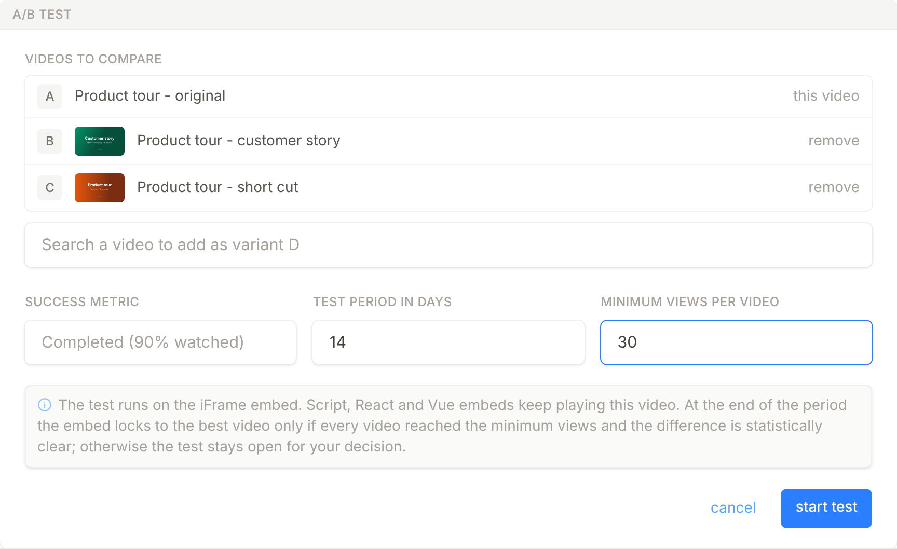
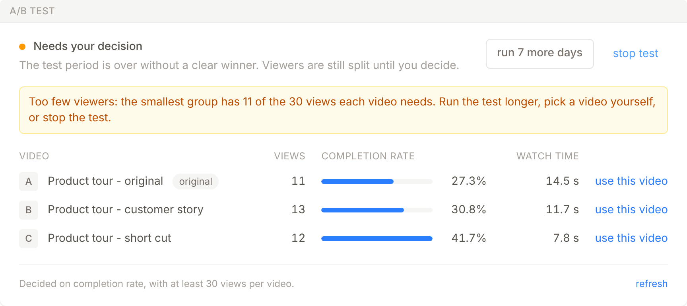
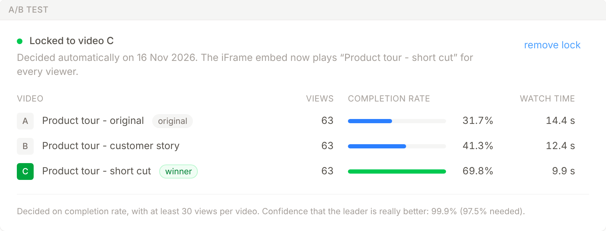

# A/B tests

An A/B test compares the video of an embed with up to three other videos from
the same space, behind the same iframe embed code. This is a first version;
the limits below are deliberate.

## Running a test

Open a video in the dashboard and choose **set up test** in the A/B test
section. Add the videos to compare, pick the success metric, the test period
(1 to 90 days) and the minimum number of views each video needs (30 or more).
The video you started from is always variant A.

Variants are ordinary library videos: upload each cut as its own video first.
They must be ready, public and have a picture.

| Metric | A view scores |
| --- | --- |
| Watch time per view | the seconds it actually played |
| Completion rate | whether playback reached 90% of the video |

A view is one viewer session with at least one second of playback. Clicks on a
call to action are not a metric, because Mave does not record them.

## What viewers get

While a test runs, the embed page (`{embed}/player.html`, the page the iframe
snippet loads) assigns each viewer one variant at random with equal chance and
remembers it in the browser's `localStorage`, so a returning viewer keeps the
same video. The page plays the variant under its own embed ID.

Only the iframe embed takes part. Script, React and Vue embeds load the
embed's manifest directly and keep playing the original video; splitting them
needs a change in the player components.

## Counting

Playback events carry the page they were sent from. A view counts towards a
test when it played one of the variants, came from the tested embed's page and
fell inside the test period. The same video embedded elsewhere does not
influence the result, and neither do plays of the original through other embed
types.

## The decision

The result is evaluated once, when the period ends
(`MaveCore.Workers.ExperimentWorker`, every five minutes). Looking at the
numbers earlier does not end a test.

- **Winner.** Every variant reached the minimum views and the leader beats
  each other variant at 95% confidence. The embed page is locked to the
  winner. With more than two variants the allowed error is divided across the
  comparisons.
- **Needs your decision.** A variant has too few views, or the difference
  could be chance. Nothing is locked and viewers keep being split until
  someone runs the test longer, picks a video by hand, or stops the test.

Watch time is compared with Welch's test and completion with a two-proportion
test, both using a normal approximation. See `MaveCore.Experiments.Stats`.

Locking changes the embed page only. Remove the lock to return to the original
video. After a lock to another video its views are recorded under that video,
not under the embed that shows it.

## Limits of this version

- One test per embed at a time, with an equal split over at most four videos.
- A variant that is deleted leaves the test; making a variant private while a
  test runs is not picked up until the embed page is published again.
- Viewers who block `localStorage` get a new random variant on every load.
- The embed page is cached by the CDN. Core purges it on every change where a
  purge is configured; otherwise a change takes effect when the cache expires.
