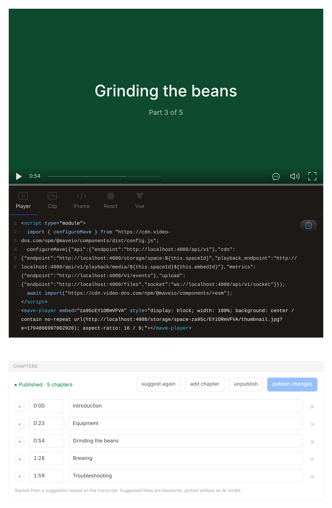

# Chapters

Chapters split a video into named parts, so viewers can jump to the part they
need. Core suggests chapters from what is said in the video; a person reviews
them on the video page and publishes them.

- A suggestion is a **draft**. Drafts are never visible to viewers.
- **Publish** copies the draft to the published chapters. Later edits stay in
  the draft until they are published again; **Unpublish** removes the chapters
  from playback and keeps the draft.
- Chapters belong to one video version. A replacement video starts without
  chapters.

<a href="images/dashboard-chapters.png"></a>

## Suggestions

A suggestion needs a timed transcript: the transcription Core generated, or any
uploaded WebVTT subtitle file. The transcript in the video's own language is
preferred over translations. When the audio-description steps analysed the
video, their scene cuts (`audio_description/scenes.json`) are used as well: a
chapter that starts right after a cut starts on the cut. A video without a
transcript gets no suggestion; chapters can still be added by hand.

Suggestions are requested in two ways:

- **On the video page**, with *suggest chapters*. A new suggestion replaces the
  draft, after confirmation when the draft has chapters.
- **Automatically**, for spaces that turn on **Settings → Features → Automatic
  chapters**: when a transcription finishes or a subtitle file is uploaded, and
  nobody has worked on that video's chapters yet.

Both run `MaveCore.Workers.ChapterSuggestionWorker` in the `flow_low` queue.
The request is not a flow step, so it needs no template change and never
affects a processing run.

A writer proposes topic changes and titles. `MaveCore.Chapters.Suggester` then
checks every proposal the same way: the first chapter starts at zero, starts
move to the beginning of the nearest spoken line, chapters that are too short
are merged, and titles are tidied. Videos shorter than a minute get no
suggestion.

| Writer | Used when | Titles |
| --- | --- | --- |
| `MaveCore.Chapters.MistralWriter` | `MISTRAL_API_KEY` is set | Short titles in the transcript's language |
| `MaveCore.Chapters.LocalWriter` | Otherwise, and when the other writer fails | The keywords that set a chapter apart |

The local writer makes no external calls. It compares the words spoken before
and after every gap between two lines (lexical cohesion, after TextTiling) and
uses pauses, sentence ends and scene cuts to place the boundary. Its titles are
keywords, meant as a starting point. It can also suggest chapters in a video
about a single subject; that is what the review step is for.

The Mistral writer sends the transcript text, its timestamps and scene-cut
times in one request, and nothing else. Transcripts over 250,000 characters
use the local writer.

| Variable | Default | Purpose |
| --- | --- | --- |
| `MISTRAL_API_KEY` | — | Already used for transcription; enables the Mistral writer |
| `MAVE_CHAPTERS_MODEL` | `mistral-large-4-0` | Chat model of the Mistral writer |
| `MAVE_CHAPTERS_WRITER` | — | `local` uses the local writer even with an API key |

`config :mave_core, :chapters, writer: Module` selects another module that
implements `MaveCore.Chapters.Writer`. Requests of the Mistral writer are
reported to `:usage_recorder` with category `chapters`.

## Published output

Publishing writes a WebVTT chapters file next to the video version and lists the
chapters in the manifest. The `chapters` key is absent when nothing is published.

```json
"chapters": {
  "path": "https://…/<embed>/chapters.vtt?e=1794865452750800",
  "cues": [
    {"start": 0.0, "end": 23.2, "title": "Introduction"},
    {"start": 23.2, "end": 54.2, "title": "Equipment"}
  ]
}
```

A chapter ends where the next one starts; the last one ends with the video.
`chapters.vtt` holds the same cues and can be used as a
`<track kind="chapters">`. Video objects in the JWT collection response carry
the same cues as `chapters` (an empty list without published chapters).

The dashboard preview shows the draft on the player's timeline through a
chapters text track. The hosted player components do not read `chapters` from
the manifest yet.

## Host policy

`MaveCore.UsageLimits.can_use_automatic_chapters?/1` is an optional host
callback. When it refuses, the settings toggle cannot be turned on, suggestions
are not requested, and *suggest chapters* is hidden. Adding, editing and
publishing chapters by hand stays available. `restriction_copy(:automatic_chapters, reason)`
supplies the notice shown next to the toggle. Without the callback, suggestions
are allowed.
