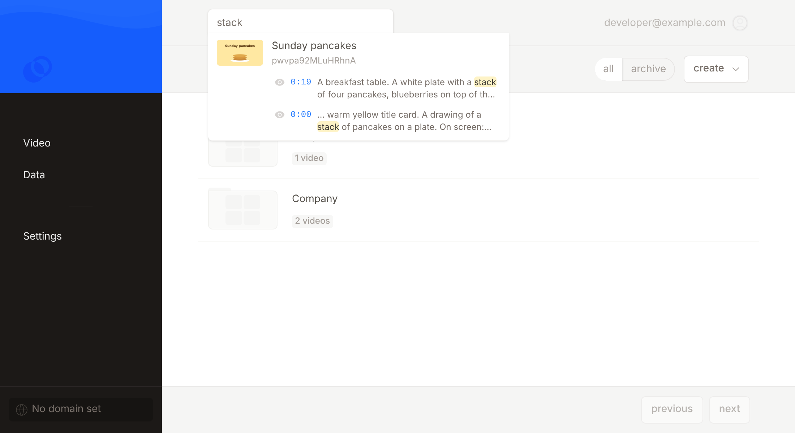

# Searchable video

Searchable video finds videos by what happens on screen and what is said, and
returns the moments where that happens. A space opts in under **Settings →
Features → Searchable video**. From then on, every new upload and reprocessing
run stores searchable text for the processed video version:

- **Visual moments** describe what is visible: the setting, people and objects,
  actions and readable text of each sampled frame. They reuse the image analysis
  of [audio description](audio_description.md), with the same 10-minute limit.
- **Transcript moments** are the spoken words, grouped into passages of a few
  seconds. Longer videos, and videos without a video stream, are indexed on
  their transcript only.

Existing videos become searchable when they are processed again.

## Searching



The dashboard search box matches names as before and adds content matches below
them. A content match shows up to two moments with their timestamp, an icon for
the source (seen or said) and the matching words highlighted. Choosing a moment
opens the video and starts playback there (`?t=<seconds>` on the video page). On
a folder page the dropdown offers **Search in: this folder / Entire library**;
a folder search includes the folders nested in it.

Every word of the query must occur in one moment or in the video name. The last
letters may be missing, so results appear while typing. Matching ignores case
and accents and works for any language, but it is literal: `bike` finds
`bikes`, not `bicycle` or `cycling`. Videos whose name matches rank first, then
moments are ranked by how often and how closely together the words occur.

Results only contain the current version of videos in the searched space that
are not deleted or archived.

## API

`GET /v1/search` needs an API key (read-only is enough) and searches the key's
space:

| Parameter | Default | Purpose |
| --- | --- | --- |
| `q` | required | The query, at most 200 characters. Up to 8 words are used. |
| `collection` | entire library | Collection ID; includes nested collections. |
| `limit` | `10` | Videos to return, at most 50. |
| `moments` | `3` | Moments per video, at most 10. |

```sh
curl -H "Authorization: Bearer $MAVE_API_KEY" \
  "https://api.example.com/v1/search?q=red+bicycle"
```

```json
{
  "object": "list",
  "query": "red bicycle",
  "data": [
    {
      "object": "search_result",
      "id": "ubg50LeDE9bpkTxpsNnD",
      "name": "City tour",
      "visibility": "public",
      "duration": 94.2,
      "poster_image": "https://…/poster.webp",
      "matched_on": ["visual"],
      "score": 0.24,
      "moments": [
        {
          "source": "visual",
          "start": 12.0,
          "end": 15.0,
          "text": "A quiet street. A woman, a red bicycle. She leans the bicycle against a wall.",
          "snippet": [
            {"text": "A quiet street. A woman, a ", "match": false},
            {"text": "red", "match": true},
            {"text": " ", "match": false},
            {"text": "bicycle", "match": true},
            {"text": ". She leans the …", "match": false}
          ]
        }
      ]
    }
  ]
}
```

`matched_on` lists `title`, `visual` and `transcript`. A video that only matches
by name has no moments. `snippet` is the passage around the first match, split
into parts so a client can highlight without parsing markup.

`GET /v1/collection/:token/search?q=…` is the same search for browser
components. It takes the signed collection token that `<mave-list>` already
uses instead of an API key: a token for a collection searches that collection
and the collections nested in it, a token for the space searches the entire
library. The token decides the scope; it cannot be widened with a parameter.
Both routes are also available under `/api/v1`.

## Flow step

The publishing presets (`publish_default`, `publish_local`, `publish_remote`,
`publish_remote_local`) contain one more optional background step. It skips
itself (`status: "skipped"`, `reason: "not_requested"`) unless the run input has
`search`, and nothing in the publish path waits for it.

| Step | Type | Runs on | Does |
| --- | --- | --- | --- |
| `index_search` | `search.index_video` | inline | Collects visual and transcript moments and stores them as a private document |

Run input:

```json
{"search": {"sources": ["visual", "transcript"]}}
```

Uploads and the public `input_url` API add this when the space has the feature on
and the host allows it at that moment. `media.detect_scenes` also runs for a run
that asks for the `visual` source, so stills exist without audio description.

The step reads `<embed>/vN/audio_description/observations.json` when audio
description already produced it. Otherwise it asks the same vision provider for
observations of the stills and saves them at that key, so whichever feature runs
first pays for the image analysis and the other one reuses it. Subtitles burned
into the picture are left out of visual moments, because the transcript already
contains them.

One source failing does not stop the other: the output has a `visual` and a
`transcript` report with `status` (`ok`, `skipped` or `unavailable`) and a
reason. Transient provider and storage errors are retried with the flow
engine's retry budget.

The result is the private object `<embed>/vN/search/moments.json`:

```json
{
  "schema_version": 1,
  "language": "en",
  "moments": [
    {"source": "visual", "start": 12.0, "end": 15.0, "text": "A quiet street. …"},
    {"source": "transcript", "start": 13.2, "end": 19.8, "text": "Welcome to the tour."}
  ]
}
```

When the step succeeds, Core replaces the rows of that video version in the
PostgreSQL table `video_search_moments`. Search uses PostgreSQL full-text search
with the language-neutral `simple` configuration and a GIN index; no separate
search service is needed. Rows are removed with their video.

## Who may use it

`MaveCore.UsageLimits.can_use_video_search?/1` is an optional host callback.
Without a host policy every space may turn the feature on. A host can refuse
with `{:error, reason}` and provide `restriction_copy(:video_search, reason)`;
the dashboard then shows the notice and keeps the toggle off. Turning the
feature off is always allowed. The check is repeated for every new run.

Turning the feature off stops indexing new runs. Moments that are already
indexed stay searchable.

## Providers and limits

Visual moments send video stills to the vision provider configured for audio
description (see its [providers](audio_description.md#providers-and-configuration));
without that provider a video is indexed on its transcript only. Requests are
reported through the same optional usage recorder.

This first version does not include:

- matching by meaning (stemming, synonyms or embeddings);
- a backfill for videos processed before the feature was enabled;
- rate limiting specific to the token search route;
- cleanup of the moments of a replaced video version before that version is
  deleted. Search never returns them.
